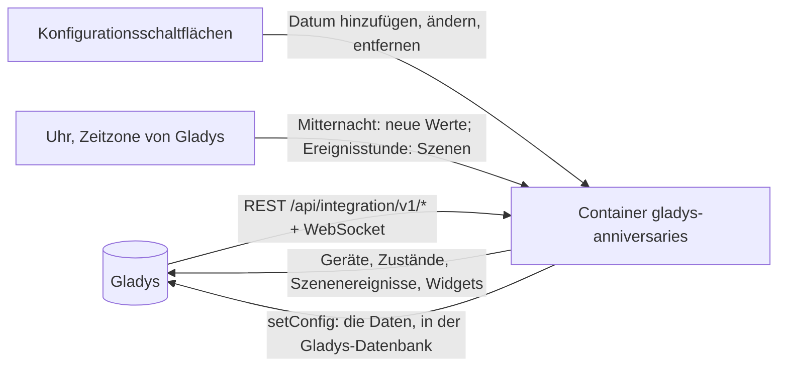
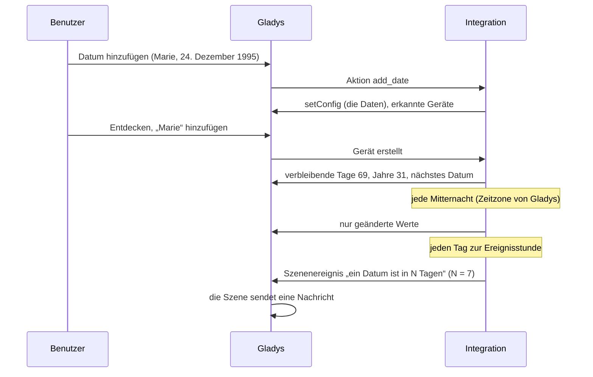
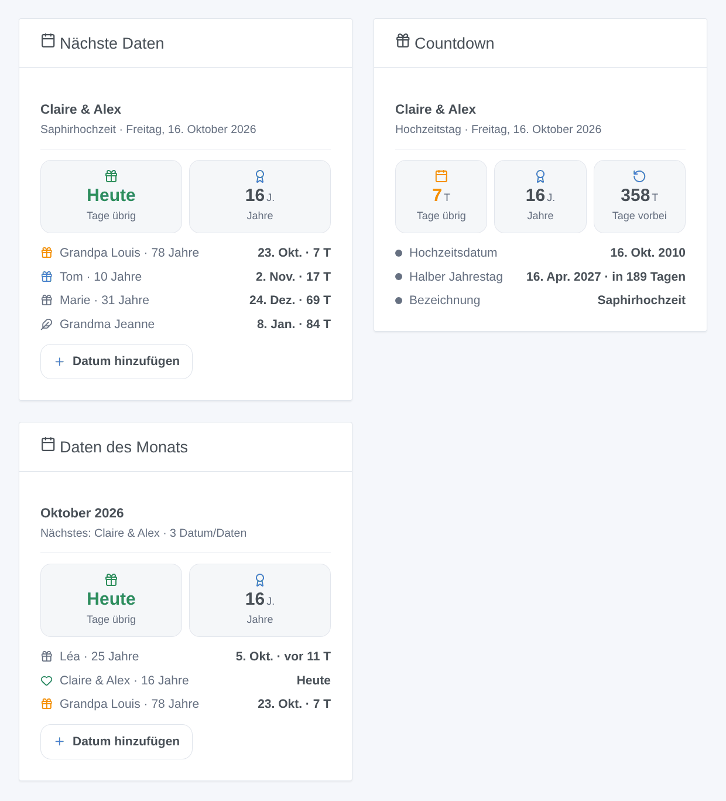

# Gladys Anniversaries

[English](README.md) · [Français](README.fr.md) · **Deutsch** · [Español](README.es.md)

[](LICENSE)
[](https://github.com/William-De71/gladys-anniversaries/releases)
[](https://github.com/William-De71/gladys-anniversaries/actions/workflows/release.yml)
[](https://gladysassistant.com)


Externe Integration für [Gladys Assistant](https://gladysassistant.com), die die Tage bis zu Geburtstagen, Hochzeitstagen und wichtigen Daten zählt: verbleibende Tage, erreichte Jahre, Szenen am Tag selbst oder einige Tage vorher und Dashboard-Widgets. Alles wird in Ihrem Gladys berechnet: kein Konto, kein Onlinedienst.

Benutzerdokumentation: [English](docs/en.md) · [Français](docs/fr.md) · [Deutsch](docs/de.md) · [Español](docs/es.md).

## Funktionen

- Daten in **einfachen Formularen** der Konfiguration eingegeben (kein JSON): mit oder ohne Jahr, jedes Jahr oder nur einmal, Art, eigene Erinnerung, Optionen „vergangene Tage zählen“ und „halber Jahrestag“ (die Optionen der Home-Assistant-Integration [Anniversaries](https://github.com/pinkywafer/Anniversaries)).
- **Ein Gerät pro Datum**: verbleibende Tage, Jahre am nächsten Jahrestag, bisherige Jahre, vergangene Tage, Tage bis zum halben Jahrestag, nächstes Datum.
- **4 Szenen-Auslöser**, **1 Szenen-Aktion** und **3 Dashboard-Widgets**, mit einer Schaltfläche **Datum hinzufügen** im Dashboard (unten).
- Die traditionellen Namen der **Hochzeitstage** (Papier-, Porzellan-, Goldene Hochzeit …), jede Sprache mit ihrer eigenen Tradition.
- Tage in der **Zeitzone von Gladys** berechnet, Wechsel um ihre Mitternacht; der 29. Februar fällt in den anderen Jahren auf den 28. Februar.
- Vier Sprachen überall: Englisch, Französisch, Deutsch, Spanisch.

## Funktionsweise




Von einem neuen Datum zu einer Szene:



### Transport

`transports: ["local"]`: Die Integration ruft keinen Netzwerkdienst auf. Keine Daten verlassen Ihr Gladys.

## Geräte und Funktionen

| Gerät          | Funktionen (Kategorie / Typ)                                                                                                                                                                                               |
| -------------- | -------------------------------------------------------------------------------------------------------------------------------------------------------------------------------------------------------------------------- |
| Eins pro Datum | Verbleibende Tage (`duration` / `integer`, Tage), Jahre am nächsten Jahrestag und bisherige Jahre (`duration`, Jahre; mit Jahr), vergangene Tage (Option), Tage bis zum halben Jahrestag (Option), nächstes Datum (`text`) |

Die External-IDs beruhen auf einer zufälligen Kennung, die jedes Datum beim Hinzufügen erhält und für immer behält, nie auf seinem Namen: Ein umbenanntes Datum behält sein Gerät.

## Szenen-Auslöser, Aktionen und Widgets



**Widgets**: Nächste Daten (das nächste mit seinen Kacheln hervorgehoben, dann bis zu 7 weitere als Zeilen über die ganze Breite: Symbol der Art, Name und Jahre, Tag und verbleibende Tage; Filter nach Arten und einer Anzahl von Tagen), Countdown (ein Datum: verbleibende Tage, Jahre, vergangene Tage, Hochzeits- oder Ereignisdatum, halber Jahrestag, Bezeichnung), Daten des Monats (dieser oder nächster Monat, vergangene Tage inbegriffen, das nächste hervorgehoben). Nächste Daten und Daten des Monats haben eine Schaltfläche **Datum hinzufügen** (in den Widget-Einstellungen ausblendbar): Name, Datum mit dem Tag zuerst, Art, Wiederholung.

**Auslöser** (einmal am Tag zu einer einstellbaren Stunde, nie zweimal für dasselbe Datum am selben Tag): ein Datum ist heute; ein Datum ist in N Tagen (N von 1 bis 60); Erinnerung an ein Datum (seine eigene Anzahl Tage oder die Standard-Erinnerung); ein Datum erreicht 1.000 Tage (alle 1.000 Tage seit einem Datum mit bekanntem Jahr). Filter: das Datum, die Arten, nur runde Jahre (10, 20, 25, 30 … und 18 bei einem Geburtstag). Variablen: Name, Art, Jahre, Name der Hochzeit, Geburts- oder Ereignisdatum, Tag, verbleibende Tage, Zusammenfassungssatz.

**Aktion**: die nächsten Daten innerhalb von N Tagen abrufen: Anzahl, Zusammenfassung (eine Zeile pro Datum), nächstes Datum.

Beispiele:

- Wenn heute ein Geburtstag ist → die Zusammenfassung an die Familie senden und das Wohnzimmerlicht festlich färben.
- Wenn ein Hochzeitstag in 7 Tagen ist → sich selbst eine Nachricht senden, um das Restaurant zu reservieren.
- Jeden Montag um 8:00 → die nächsten Daten innerhalb von 7 Tagen abrufen → die Zusammenfassung senden.

## Voraussetzungen

- Gladys Assistant **5.2.0** oder neuer (Widget-Schaltflächen mit Formular): Ältere Instanzen können die Integration nicht installieren.
- Die Zeitzone von Gladys richtig eingestellt (Einstellungen > System).

## Installation

- **Aus dem Store**: Integrationen → Anniversaries → Installieren.
- **Über die URL des Repositorys**: Integrationen → externe Integration → `https://github.com/William-De71/gladys-anniversaries`.
- **Entwicklermodus**: `npm start` mit den von Gladys gelieferten Variablen ausführen (siehe Entwicklung).

## Konfiguration

| Feld oder Schaltfläche          | Standard    | Bedeutung                                                                   |
| ------------------------------- | ----------- | --------------------------------------------------------------------------- |
| Uhrzeit der Szenenereignisse    | 9           | 0 bis 23, in der Zeitzone von Gladys                                        |
| Standard-Erinnerung             | 7 Tage      | 0 bis 60; für Daten ohne eigene Erinnerung                                  |
| Sprache der Texte               | automatisch | Funktionsnamen, nächstes Datum, Szenen-Zusammenfassungen, Meldungen         |
| Hinzufügen / Ändern / Entfernen | —           | Ein Formular pro Datum: Name, Tag, Monat, Jahr, Art, Wiederholung, Optionen |
| Daten auflisten                 | —           | Jedes Datum mit Nummer, nächstem Termin, verwendetem Tag und Zeitzone       |

## Verwendung

1. **Datum hinzufügen** für jeden Geburtstag oder jedes Datum (Integrationen → Anniversaries → Konfiguration).
2. **Entdecken**, dann die gewünschten Daten als Geräte hinzufügen.
3. Die Widgets zu einem Dashboard hinzufügen und Szenen mit den Auslösern und der Aktion erstellen.

## Entwicklung

```bash
npm install
npm test                       # node --test, berührt nie das Netzwerk
npm run lint                   # ESLint
npm run format:check           # Prettier
npx github:GladysAssistant/integration-store . --skip-image-check
scripts/build-cover.sh         # cover.jpg aus docs/assets/cover.svg
docs/illustrations/render.sh   # docs/assets/widgets.<sprache>.png
```

Lokal liest das SDK `GLADYS_HOST_API_URL`, `GLADYS_INTEGRATION_TOKEN` und `GLADYS_INTEGRATION_SELECTOR` (von Gladys im Entwicklermodus geliefert), die Integration liest `TZ`. `DEBUG=gladys-integration-sdk` zeigt die SDK-Protokolle.

Die Tests decken die Datumsberechnung (Jahre, 29. Februar, halber Jahrestag, einmalige Daten), die Formulare und das Register, die Geräte (die vom Erkennungsbildschirm verlangten Felder), die Widgets (`validateWidgetContent`), die Szenenereignisse und -ausgaben, die Uhr (Mitternacht, Ereignisstunde, nie zweimal am Tag, erneuter Versuch nach einer Ablehnung), das Manifest, die vier Sprachen, das Release-Skript und die ganze Integration gegen das falsche Gladys des SDK ab. `test/structure.test.js` friert jeden von Benutzern gespeicherten Schlüssel ein.

## Release-Prozess


Jeder Merge auf `main` startet die CI und berechnet dann die Version aus den [Conventional Commits](https://www.conventionalcommits.org/) seit dem letzten Tag: `feat` → Minor, `fix` / `perf` → Patch, `!` oder `BREAKING CHANGE` → Major (ein Minor unter 1.0.0); `docs`, `chore`, `ci`, `test`, `style`, `refactor`, `build` allein veröffentlichen nichts. Der Changelog-Abschnitt wird erzeugt, der Tag gepusht, das Multi-Architektur-Image gebaut, dann erhält `main` den Release-Commit, das GitHub Release wird erstellt und ein letzter Job prüft das öffentliche Image, den Store-Validator und das Topic.

- Der Titel des Pull Requests wird zum Squash-Commit und dann zur Changelog-Zeile: auf Englisch, für den Benutzer (`pr-title.yml` prüft ihn). `CHANGELOG.md` nie von Hand bearbeiten.
- 1.0.0 ist eine Entscheidung: Actions → Release → Run workflow mit `release-as: 1.0.0`. `dry-run` zeigt Version und Notizen, ohne zu veröffentlichen.
- **Geschützter Branch**: Das Release pusht seinen Commit mit `GITHUB_TOKEN` auf `main`. Mit einem Ruleset auf `main` GitHub Actions zur Bypass-Liste hinzufügen (oder über eine GitHub App pushen), sonst schlägt der Veröffentlichungsjob mit Anweisungen fehl.
- Nach dem ersten Release das Paket `ghcr.io` öffentlich machen (Package settings → Change visibility), sonst kann Gladys es nicht laden.

## Fehlerbehebung

Siehe [docs/de.md](docs/de.md#fehlerbehebung). Melden Sie Probleme mit den Versionen von Gladys und der Integration, dem Ergebnis von „Daten auflisten“ und den Protokollen der Integration.

## Mitwirken

Issues und Pull Requests sind willkommen. Führen Sie vor einem Pull Request `npm run format:check && npm run lint && npm test` aus und lassen Sie alle External-IDs und gespeicherten Schlüssel unverändert (siehe [CLAUDE.md](CLAUDE.md)).

## Sicherheit

Siehe [SECURITY.md](SECURITY.md): Schwachstellen vertraulich melden. Die Integration hält kein Geheimnis und öffnet keine Netzwerkverbindung außer zu Gladys.

## Kommende Screenshots

Die Bilder oben sind Illustrationen, keine Screenshots. Echte Screenshots kommen nach `docs/assets/screenshots/` (PNG, 1280 × 800): `configuration.png` (das Formular „Datum hinzufügen“), `discovery.png`, `device.png`, `scene.png`.

## Lizenz

[Apache-Lizenz 2.0](LICENSE) — siehe auch [NOTICE](NOTICE). Dank an die Dokumentation und das SDK von Gladys sowie an die Home-Assistant-Integration Anniversaries von pinkywafer für ihre Optionen.
