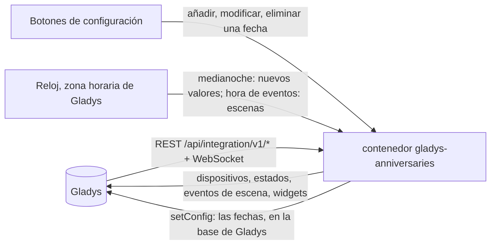
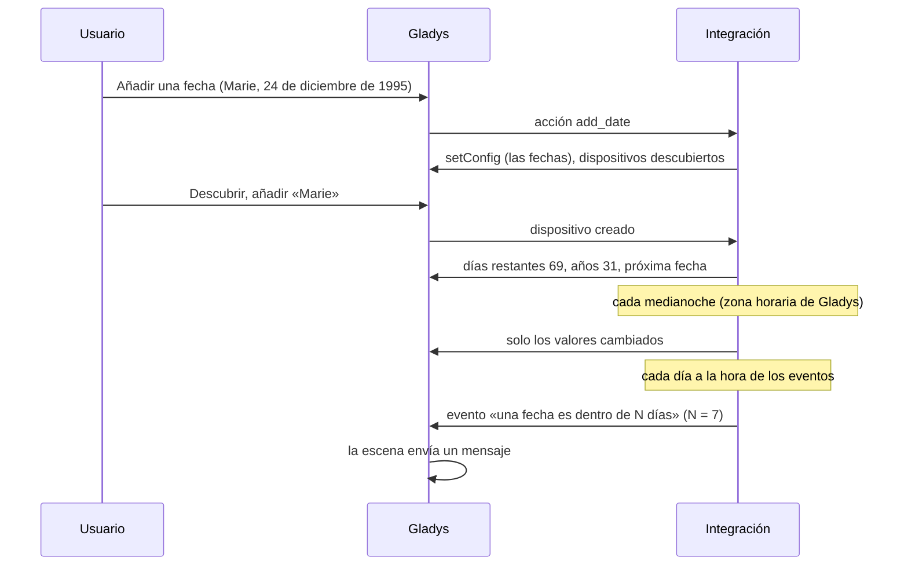
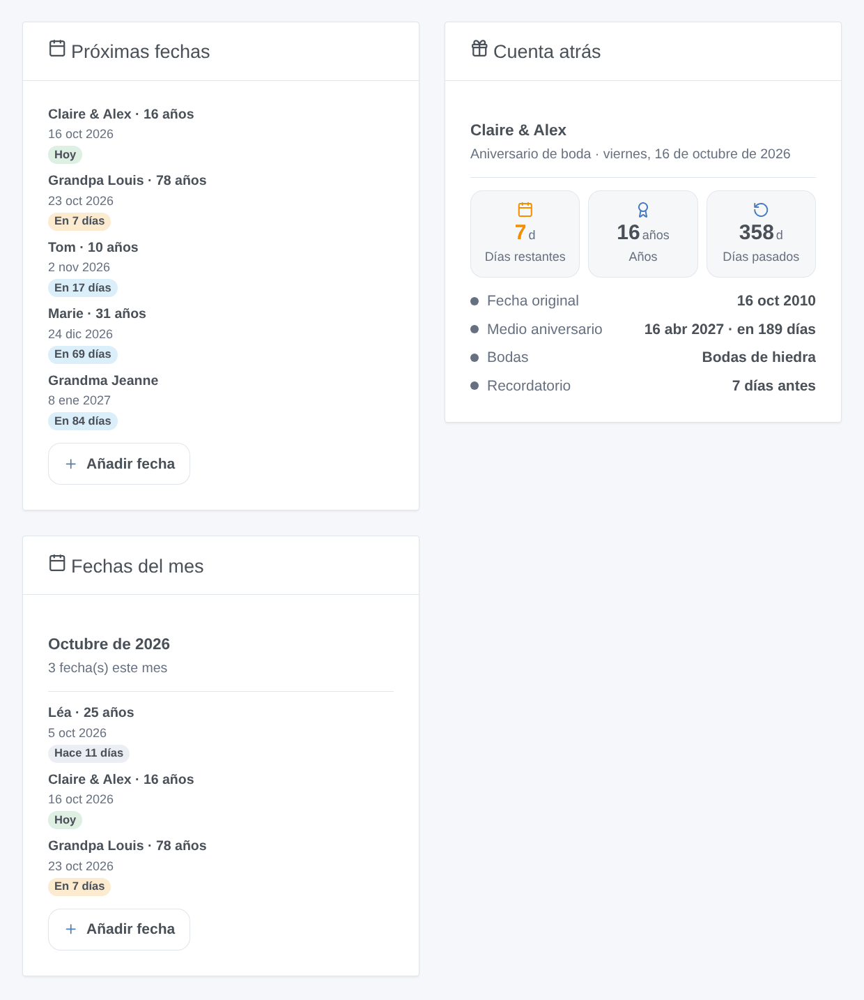

# Gladys Anniversaries

[English](README.md) · [Français](README.fr.md) · [Deutsch](README.de.md) · **Español**

[](LICENSE)
[](https://github.com/William-De71/gladys-anniversaries/releases)
[](https://github.com/William-De71/gladys-anniversaries/actions/workflows/release.yml)
[](https://gladysassistant.com)


Integración externa de [Gladys Assistant](https://gladysassistant.com) que hace la cuenta atrás de cumpleaños, aniversarios de boda y fechas importantes: días restantes, años cumplidos, escenas el mismo día o unos días antes, y widgets del panel. Todo se calcula en su Gladys: ni cuenta, ni servicio en línea.

Documentación de usuario: [English](docs/en.md) · [Français](docs/fr.md) · [Deutsch](docs/de.md) · [Español](docs/es.md).

## Funciones

- Fechas introducidas en **formularios sencillos** de la configuración (sin JSON): con o sin año, cada año o una sola vez, tipo, recordatorio propio, opciones «contar los días pasados» y «medio aniversario» (las opciones de la integración de Home Assistant [Anniversaries](https://github.com/pinkywafer/Anniversaries)).
- **Un dispositivo por fecha**: días restantes, años en el próximo aniversario, años transcurridos, días pasados, días hasta el medio aniversario, próxima fecha.
- **4 disparadores de escena**, **1 acción de escena** y **3 widgets**, con un botón **Añadir fecha** en el panel (abajo).
- El nombre tradicional de los **aniversarios de boda** (bodas de papel, de porcelana, de oro…), cada idioma con su propia tradición.
- Días calculados en la **zona horaria de Gladys**, que cambian a su medianoche; el 29 de febrero cae el 28 de febrero los demás años.
- Cuatro idiomas en todas partes: inglés, francés, alemán, español.

## Funcionamiento




De una nueva fecha a una escena:



### Transporte

`transports: ["local"]`: la integración no llama a ningún servicio de red. Ningún dato sale de su Gladys.

## Dispositivos y funciones

| Dispositivo   | Funciones (categoría / tipo)                                                                                                                                                                                               |
| ------------- | -------------------------------------------------------------------------------------------------------------------------------------------------------------------------------------------------------------------------- |
| Uno por fecha | Días restantes (`duration` / `integer`, días), años en el próximo aniversario y años transcurridos (`duration`, años; con el año), días pasados (opción), días hasta el medio aniversario (opción), próxima fecha (`text`) |

Los external_id se basan en un identificador aleatorio dado a cada fecha al añadirla y conservado para siempre, nunca en su nombre: renombrar una fecha conserva su dispositivo.

## Disparadores, acciones de escena y widgets



**Widgets**: Próximas fechas (1 a 8, con años, día e insignia; filtros por tipos y por un número de días), Cuenta atrás (una fecha: días restantes, años, días pasados, fecha original, medio aniversario, bodas, recordatorio), Fechas del mes (este mes o el siguiente, días pasados incluidos). Próximas fechas y Fechas del mes tienen un botón **Añadir fecha**: nombre, fecha escrita empezando por el día, tipo, repetición.

**Disparadores** (una vez al día a una hora configurable, nunca dos veces para la misma fecha el mismo día): una fecha es hoy; una fecha es dentro de N días (N de 1 a 60); recordatorio de una fecha (su propio número de días o el predeterminado); una fecha alcanza 1000 días (cada 1000 días desde una fecha con año conocido). Filtros: la fecha, los tipos, solo años redondos (10, 20, 25, 30… y 18 en un cumpleaños). Variables: nombre, tipo, años, nombre de las bodas, fecha original, día, días restantes, frase de resumen.

**Acción**: obtener las próximas fechas dentro de N días: número, resumen (una línea por fecha), fecha más cercana.

Ejemplos:

- Cuando un cumpleaños es hoy → enviar el resumen a la familia y poner la luz del salón en un color festivo.
- Cuando un aniversario de boda es dentro de 7 días → enviarse un mensaje para reservar el restaurante.
- Cada lunes a las 8:00 → obtener las próximas fechas en 7 días → enviar el resumen.

## Requisitos

- Gladys Assistant **5.2.0** o posterior (botones de widget con formulario): las instancias más antiguas no pueden instalar la integración.
- La zona horaria de Gladys bien configurada (Ajustes > Sistema).

## Instalación

- **Desde la tienda**: Integraciones → Anniversaries → Instalar.
- **Desde la URL del repositorio**: Integraciones → integración externa → `https://github.com/William-De71/gladys-anniversaries`.
- **Modo desarrollador**: ejecute `npm start` con las variables que da Gladys (ver Desarrollo).

## Configuración

| Campo o botón                 | Por defecto | Significado                                                                |
| ----------------------------- | ----------- | -------------------------------------------------------------------------- |
| Hora de los eventos de escena | 9           | 0 a 23, en la zona horaria de Gladys                                       |
| Recordatorio por defecto      | 7 días      | 0 a 60; para las fechas sin recordatorio propio                            |
| Idioma de los textos          | automático  | Nombres de funciones, próxima fecha, resúmenes de escenas, mensajes        |
| Añadir / Modificar / Eliminar | —           | Un formulario por fecha: nombre, día, mes, año, tipo, repetición, opciones |
| Listar las fechas             | —           | Cada fecha con su número, próxima vez, el día y la zona horaria usados     |

## Uso

1. **Añadir una fecha** para cada cumpleaños o fecha (Integraciones → Anniversaries → Configuración).
2. **Descubrir**, y luego añada como dispositivos las fechas que quiera.
3. Añada los widgets a un panel y cree escenas con los disparadores y la acción.

## Desarrollo

```bash
npm install
npm test                       # node --test, nunca toca la red
npm run lint                   # ESLint
npm run format:check           # Prettier
npx github:GladysAssistant/integration-store . --skip-image-check
scripts/build-cover.sh         # cover.jpg desde docs/assets/cover.svg
docs/illustrations/render.sh   # docs/assets/widgets.<idioma>.png
```

En local, el SDK lee `GLADYS_HOST_API_URL`, `GLADYS_INTEGRATION_TOKEN` y `GLADYS_INTEGRATION_SELECTOR` (que da Gladys en modo desarrollador), y la integración lee `TZ`. `DEBUG=gladys-integration-sdk` muestra los registros del SDK.

Las pruebas cubren el cálculo de fechas (años, 29 de febrero, medio aniversario, fechas únicas), los formularios y el registro, los dispositivos (los campos que exige la pantalla de descubrimiento), los widgets (`validateWidgetContent`), los eventos y salidas de escena, el reloj (medianoche, hora de eventos, nunca dos veces al día, nuevo intento tras un rechazo), el manifiesto, los cuatro idiomas, el script de release y toda la integración frente al Gladys falso del SDK. `test/structure.test.js` congela cada clave que guardan los usuarios.

## Proceso de release


Cada fusión en `main` lanza la CI y luego calcula la versión a partir de los [Conventional Commits](https://www.conventionalcommits.org/) desde la última etiqueta: `feat` → menor, `fix` / `perf` → parche, `!` o `BREAKING CHANGE` → mayor (una menor por debajo de 1.0.0); `docs`, `chore`, `ci`, `test`, `style`, `refactor`, `build` solos no publican nada. Se genera la sección del changelog, se sube la etiqueta, se construye la imagen multiarquitectura, luego `main` recibe el commit de release, se crea la GitHub Release y un último job comprueba la imagen pública, el validador de la tienda y el topic.

- El título de la pull request se convierte en el commit squash y luego en la línea del changelog: escríbalo en inglés, para el usuario (`pr-title.yml` lo comprueba). Nunca edite `CHANGELOG.md` a mano.
- La 1.0.0 es una decisión: Actions → Release → Run workflow con `release-as: 1.0.0`. `dry-run` muestra la versión y las notas sin publicar.
- **Rama protegida**: la release sube su commit a `main` con `GITHUB_TOKEN`. Con un ruleset en `main`, añada GitHub Actions a su lista de omisión (o suba mediante una GitHub App); si no, el job de publicación falla con instrucciones.
- Tras la primera release, haga público el paquete `ghcr.io` (Package settings → Change visibility); si no, Gladys no puede descargarlo.

## Solución de problemas

Ver [docs/es.md](docs/es.md#solución-de-problemas). Informe de los problemas con las versiones de Gladys y de la integración, el resultado de «Listar las fechas» y los registros de la integración.

## Contribuir

Issues y pull requests bienvenidas. Ejecute `npm run format:check && npm run lint && npm test` antes de abrir una pull request, y mantenga sin cambios todos los external_id y claves guardadas (ver [CLAUDE.md](CLAUDE.md)).

## Seguridad

Ver [SECURITY.md](SECURITY.md): informe de las vulnerabilidades en privado. La integración no guarda ningún secreto y no abre ninguna conexión de red fuera de Gladys.

## Capturas por venir

Las imágenes de arriba son ilustraciones, no capturas de pantalla. Las capturas reales irán en `docs/assets/screenshots/` (PNG, 1280 × 800): `configuration.png` (el formulario «Añadir una fecha»), `discovery.png`, `device.png`, `scene.png`.

## Licencia

[Licencia Apache 2.0](LICENSE) — ver también [NOTICE](NOTICE). Gracias a la documentación y al SDK de Gladys, y a la integración de Home Assistant Anniversaries de pinkywafer por sus opciones.
