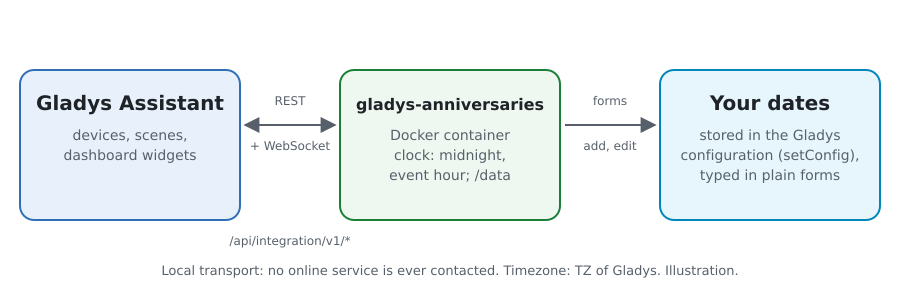
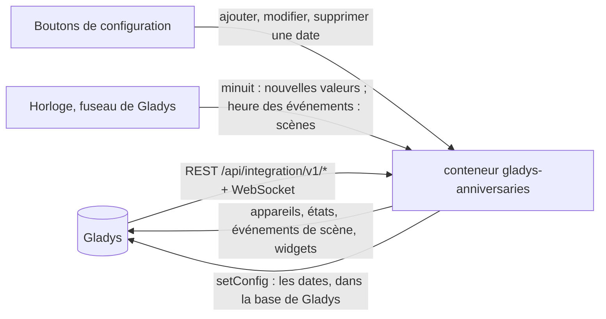
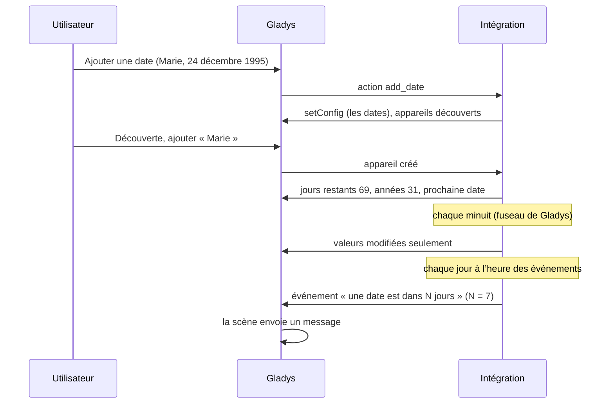
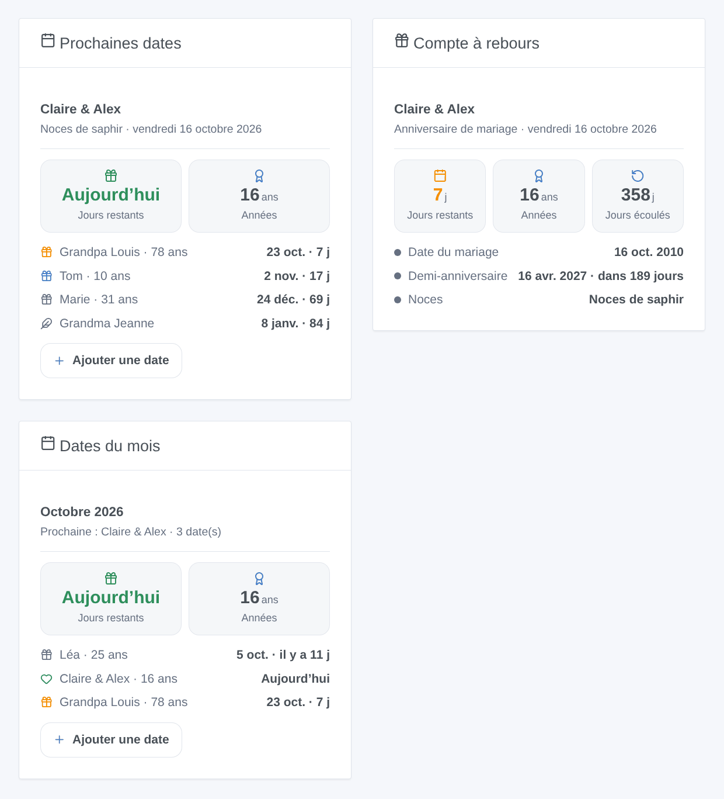

# Gladys Anniversaries

[English](README.md) · **Français** · [Deutsch](README.de.md) · [Español](README.es.md)

[](LICENSE)
[](https://github.com/William-De71/gladys-anniversaries/releases)
[](https://github.com/William-De71/gladys-anniversaries/actions/workflows/release.yml)
[](https://gladysassistant.com)


Intégration externe de [Gladys Assistant](https://gladysassistant.com) qui fait le compte à rebours des anniversaires, anniversaires de mariage et dates importantes : jours restants, années atteintes, scènes le jour J ou quelques jours avant, et widgets de tableau de bord. Tout est calculé dans votre Gladys : ni compte, ni service en ligne.

Documentation utilisateur : [English](docs/en.md) · [Français](docs/fr.md) · [Deutsch](docs/de.md) · [Español](docs/es.md).

## Fonctionnalités

- Dates saisies dans de **simples formulaires** de la configuration (pas de JSON) : avec ou sans l’année, chaque année ou une seule fois, type, rappel propre, options « compter les jours écoulés » et « demi-anniversaire » (les options de l’intégration Home Assistant [Anniversaries](https://github.com/pinkywafer/Anniversaries)).
- **Un appareil par date** : jours restants, années au prochain anniversaire, années écoulées, jours écoulés, jours avant le demi-anniversaire, prochaine date.
- **4 déclencheurs de scène**, **1 action de scène** et **3 widgets**, avec un bouton **Ajouter une date** sur le tableau de bord (ci-dessous).
- Le nom traditionnel des **noces** (coton, porcelaine, or…), chaque langue suivant sa propre tradition.
- Jours calculés dans le **fuseau horaire de Gladys**, qui changent à son minuit ; le 29 février tombe le 28 février les autres années.
- Quatre langues partout : anglais, français, allemand, espagnol.

## Fonctionnement





D’une nouvelle date à une scène :



### Transport

`transports: ["local"]` : l’intégration n’appelle aucun service réseau. Aucune donnée ne quitte votre Gladys.

## Appareils et fonctionnalités

| Appareil    | Fonctionnalités (catégorie / type)                                                                                                                                                                                                 |
| ----------- | ---------------------------------------------------------------------------------------------------------------------------------------------------------------------------------------------------------------------------------- |
| Un par date | Jours restants (`duration` / `integer`, jours), années au prochain anniversaire et années écoulées (`duration`, années ; avec l’année), jours écoulés (option), jours avant le demi-anniversaire (option), prochaine date (`text`) |

Les external_id reposent sur un identifiant aléatoire donné à chaque date à son ajout et conservé pour toujours, jamais sur son nom : renommer une date garde son appareil.

## Déclencheurs, actions de scène et widgets



**Widgets** : Prochaines dates (la plus proche mise en avant avec ses tuiles, puis jusqu’à 7 autres en lignes sur toute la largeur : icône du type, nom et années, jour et jours restants ; filtres sur les types et un nombre de jours), Compte à rebours (une date : jours restants, années, jours écoulés, date du mariage ou de l’événement, demi-anniversaire, noces), Dates du mois (ce mois-ci ou le suivant, jours passés compris, la prochaine mise en avant). Prochaines dates et Dates du mois ont un bouton **Ajouter une date** (masquable dans les réglages du widget) : nom, date saisie en commençant par le jour, type, répétition.

**Déclencheurs** (une fois par jour à une heure réglable, jamais deux fois pour la même date le même jour) : une date est aujourd’hui ; une date est dans N jours (N de 1 à 60) ; rappel d’une date (son propre nombre de jours, ou celui par défaut) ; une date atteint un millier de jours (tous les 1 000 jours depuis une date dont l’année est connue). Filtres : la date, les types, années rondes seulement (10, 20, 25, 30… et 18 ans pour un anniversaire). Variables : nom, type, années, noces, date de naissance ou de l’événement, jour, jours restants, phrase de résumé.

**Action** : obtenir les prochaines dates dans les N jours : nombre, résumé (une ligne par date), date la plus proche.

Exemples :

- Quand un anniversaire est aujourd’hui → envoyer le résumé à la famille et mettre la lumière du salon en couleur festive.
- Quand un anniversaire de mariage est dans 7 jours → vous envoyer un message pour réserver le restaurant.
- Chaque lundi à 8 h → obtenir les prochaines dates sur 7 jours → envoyer le résumé.

## Prérequis

- Gladys Assistant **5.2.0** ou plus récent (boutons de widget avec formulaire) : les instances plus anciennes ne peuvent pas installer l’intégration.
- Le fuseau horaire de Gladys correctement réglé (Paramètres > Système).

## Installation

- **Depuis le store** : Intégrations → Anniversaries → Installer.
- **Depuis l’URL du dépôt** : Intégrations → intégration externe → `https://github.com/William-De71/gladys-anniversaries`.
- **Mode développeur** : lancez `npm start` avec les variables fournies par Gladys (voir Développement).

## Configuration

| Champ ou bouton                | Défaut      | Rôle                                                                                |
| ------------------------------ | ----------- | ----------------------------------------------------------------------------------- |
| Heure des événements de scène  | 9           | 0 à 23, dans le fuseau horaire de Gladys                                            |
| Rappel par défaut              | 7 jours     | 0 à 60 ; pour les dates sans rappel propre                                          |
| Langue des textes              | automatique | Noms des fonctionnalités, prochaine date, résumés des scènes, messages des boutons  |
| Ajouter / Modifier / Supprimer | —           | Un formulaire par date : nom, jour, mois, année, type, répétition, options          |
| Lister les dates               | —           | Chaque date avec son numéro, sa prochaine occurrence, le jour et le fuseau utilisés |

## Utilisation

1. **Ajouter une date** pour chaque anniversaire ou date (Intégrations → Anniversaries → Configuration).
2. **Découverte**, puis ajoutez comme appareils les dates souhaitées.
3. Ajoutez les widgets à un tableau de bord, et créez des scènes avec les déclencheurs et l’action.

## Développement

```bash
npm install
npm test                       # node --test, ne touche jamais au réseau
npm run lint                   # ESLint
npm run format:check           # Prettier
npx github:GladysAssistant/integration-store . --skip-image-check
scripts/build-cover.sh         # cover.jpg depuis docs/assets/cover.svg
docs/illustrations/render.sh   # docs/assets/widgets.<langue>.png
```

En local, le SDK lit `GLADYS_HOST_API_URL`, `GLADYS_INTEGRATION_TOKEN` et `GLADYS_INTEGRATION_SELECTOR` (fournis par Gladys en mode développeur), et l’intégration lit `TZ`. `DEBUG=gladys-integration-sdk` affiche les journaux du SDK.

Les tests couvrent le calcul des dates (années, 29 février, demi-anniversaire, dates uniques), les formulaires et le registre, les appareils (les champs qu’exige l’écran de découverte), les widgets (`validateWidgetContent`), les événements et sorties de scène, l’horloge (minuit, heure des événements, jamais deux fois par jour, nouvel essai après un refus), le manifeste, les quatre langues, le script de release, et toute l’intégration face au faux Gladys du SDK. `test/structure.test.js` fige chaque clé que les utilisateurs enregistrent.

## Processus de release


Chaque fusion sur `main` lance la CI, puis calcule la version à partir des [Conventional Commits](https://www.conventionalcommits.org/) depuis le dernier tag : `feat` → mineure, `fix` / `perf` → correctif, `!` ou `BREAKING CHANGE` → majeure (une mineure sous 1.0.0) ; `docs`, `chore`, `ci`, `test`, `style`, `refactor`, `build` seuls ne publient rien. La section du changelog est générée, le tag poussé, l’image multi-architecture construite, puis `main` reçoit le commit de release, la GitHub Release est créée et un dernier job vérifie l’image publique, le validateur du store et le topic.

- Le titre de la pull request devient le commit squash, puis la ligne du changelog : écrivez-le en anglais, pour l’utilisateur (`pr-title.yml` le vérifie). Ne modifiez jamais `CHANGELOG.md` à la main.
- La 1.0.0 est une décision : Actions → Release → Run workflow avec `release-as: 1.0.0`. `dry-run` affiche la version et les notes sans rien publier.
- **Branche protégée** : la release pousse son commit sur `main` avec `GITHUB_TOKEN`. Avec un ruleset sur `main`, ajoutez GitHub Actions à sa liste de contournement (ou poussez via une GitHub App), sinon le job de publication échoue avec des instructions.
- Après la première release, rendez public le package `ghcr.io` (Package settings → Change visibility), sinon Gladys ne peut pas le télécharger.

## Dépannage

Voir [docs/fr.md](docs/fr.md#dépannage). Signalez les problèmes avec les versions de Gladys et de l’intégration, le résultat de « Lister les dates » et les journaux de l’intégration.

## Contribuer

Issues et pull requests bienvenues. Lancez `npm run format:check && npm run lint && npm test` avant d’ouvrir une pull request, et gardez inchangés tous les external_id et clés enregistrées (voir [CLAUDE.md](CLAUDE.md)).

## Sécurité

Voir [SECURITY.md](SECURITY.md) : signalez les vulnérabilités en privé. L’intégration ne détient aucun secret et n’ouvre aucune connexion réseau en dehors de Gladys.

## Captures à venir

Les images ci-dessus sont des illustrations, pas des captures d’écran. Les vraies captures iront dans `docs/assets/screenshots/` (PNG, 1280 × 800) : `configuration.png` (le formulaire « Ajouter une date »), `discovery.png`, `device.png`, `scene.png`.

## Licence

[Licence Apache 2.0](LICENSE) — voir aussi [NOTICE](NOTICE). Merci à la documentation et au SDK de Gladys, et à l’intégration Home Assistant Anniversaries de pinkywafer pour ses options.
