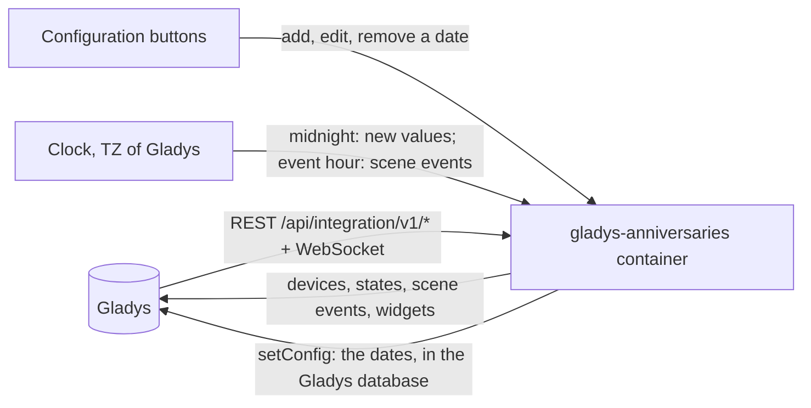
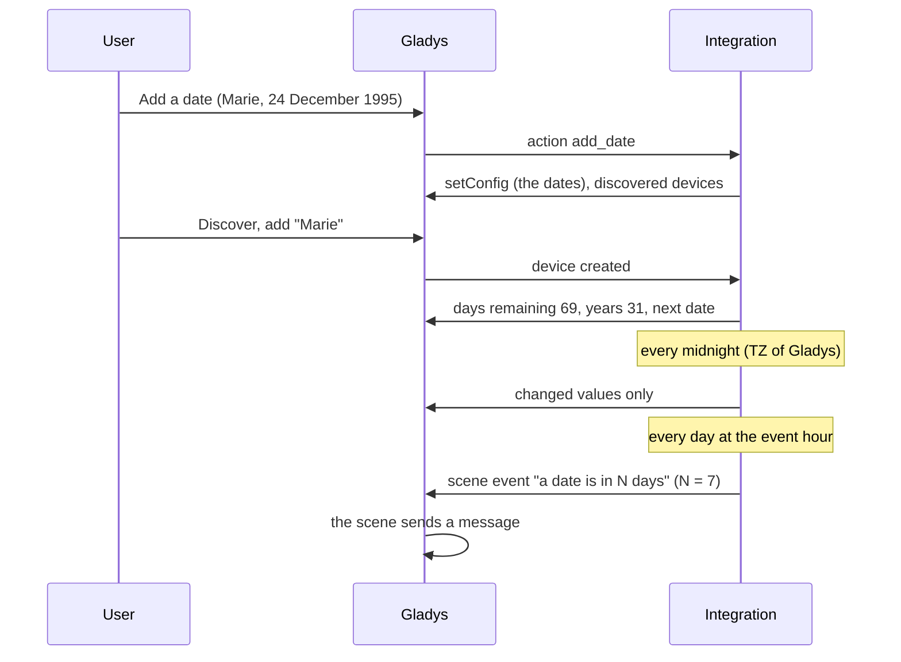
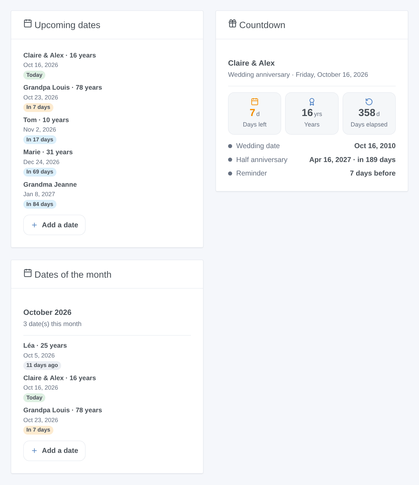

# Gladys Anniversaries

**English** · [Français](README.fr.md) · [Deutsch](README.de.md) · [Español](README.es.md)

[](LICENSE)
[](https://github.com/William-De71/gladys-anniversaries/releases)
[](https://github.com/William-De71/gladys-anniversaries/actions/workflows/release.yml)
[](https://gladysassistant.com)


[Gladys Assistant](https://gladysassistant.com) external integration that counts down to birthdays, wedding anniversaries and important dates: days left, years reached, scenes on the day or a few days before, and dashboard widgets. Everything is computed inside your Gladys: no account, no online service.

User documentation: [English](docs/en.md) · [Français](docs/fr.md) · [Deutsch](docs/de.md) · [Español](docs/es.md).

## Features

- Dates typed in **plain forms** of the configuration (no JSON): with or without the year, every year or one time only, kind, own reminder, "count up" and "half anniversary" options (the options of the Home Assistant [Anniversaries](https://github.com/pinkywafer/Anniversaries) integration).
- **One device per date**: days remaining, years at the next anniversary, years so far, days elapsed, days to the half anniversary, next date.
- **4 scene triggers**, **1 scene action** and **3 dashboard widgets**, with an **Add a date** button on the dashboard (below).
- The traditional names of **wedding anniversaries** (paper, china, golden…), each language following its own tradition.
- Days computed in the **timezone of Gladys**, changing at its midnight; 29 February falls on 28 February in the other years.
- Four languages everywhere: English, French, German, Spanish.

## How it works




From a new date to a scene:



### Transport

`transports: ["local"]`: the integration calls no network service at all. No data leaves your Gladys.

## Devices and features

| Device       | Features (category / type)                                                                                                                                                                                         |
| ------------ | ------------------------------------------------------------------------------------------------------------------------------------------------------------------------------------------------------------------ |
| One per date | Days remaining (`duration` / `integer`, days), years at the next anniversary and years so far (`duration`, years; with the year), days elapsed (option), days to the half anniversary (option), next date (`text`) |

External ids rest on a random identifier given to each date when it is added and kept for ever, never on its name: renaming a date keeps its device.

## Scene triggers, actions and widgets



**Widgets**: Upcoming dates (1 to 8, with years, day and a badge; filters on kinds and on a number of days), Countdown (one date: days left, years, days elapsed, date of birth, half anniversary, traditional name, reminder), Dates of the month (this month or the next one, past days included). Upcoming dates and Dates of the month carry an **Add a date** button: name, date typed day first, kind, repeat.

**Triggers** (once a day at a configurable hour, never twice for the same date and day): a date is today; a date is in N days (N from 1 to 60); reminder of a date (its own number of days, or the default one); a date reaches 1,000 days (every 1,000 days since a date with its year). Filters: the date, the kinds, round years only (10, 20, 25, 30… and 18 for a birthday). Variables: name, kind, years, wedding anniversary name, date of birth or of the event, day, days remaining, summary sentence.

**Action**: get the upcoming dates within N days: count, summary (one line per date), nearest date.

Examples:

- When a birthday is today → send the summary to the family and turn the living room light to a festive color.
- When a wedding anniversary is in 7 days → send yourself a message to book the restaurant.
- Every Monday at 8:00 → get the upcoming dates within 7 days → send the summary.

## Requirements

- Gladys Assistant **5.2.0** or later (widget buttons with a form): older instances cannot install the integration.
- The timezone of Gladys set correctly (Settings > System).

## Installation

- **From the store**: Integrations → Anniversaries → Install.
- **From the repository URL**: Integrations → external integration → `https://github.com/William-De71/gladys-anniversaries`.
- **Developer mode**: run `npm start` with the variables given by Gladys (see Development).

## Configuration

| Field or button       | Default   | Meaning                                                                  |
| --------------------- | --------- | ------------------------------------------------------------------------ |
| Hour of scene events  | 9         | 0 to 23, in the timezone of Gladys                                       |
| Default reminder      | 7 days    | 0 to 60; for the dates without their own                                 |
| Language of the texts | automatic | Feature names, next date, scene summaries, button messages               |
| Add / Edit / Remove   | —         | One form per date: name, day, month, year, kind, recurrence, options     |
| List the dates        | —         | Every date with its number, next occurrence, the day and timezone in use |

## Usage

1. **Add a date** for each birthday or date (Integrations → Anniversaries → Configuration).
2. **Discover**, then add the dates you want as devices.
3. Add the widgets to a dashboard, and build scenes with the triggers and the action.

## Development

```bash
npm install
npm test                       # node --test, never touches the network
npm run lint                   # ESLint
npm run format:check           # Prettier
npx github:GladysAssistant/integration-store . --skip-image-check
scripts/build-cover.sh         # cover.jpg from docs/assets/cover.svg
docs/illustrations/render.sh   # docs/assets/widgets.<lang>.png
```

Locally, the SDK reads `GLADYS_HOST_API_URL`, `GLADYS_INTEGRATION_TOKEN` and `GLADYS_INTEGRATION_SELECTOR` (given by Gladys in developer mode), and the integration reads `TZ`. `DEBUG=gladys-integration-sdk` shows the SDK logs.

The tests cover the calendar arithmetic (years, 29 February, half anniversary, one-time dates), the forms and the registry, the devices (the fields the Discovery screen requires), the widgets (`validateWidgetContent`), the scene events and outputs, the clock (midnight, event hour, never twice a day, retry after a refusal), the manifest, the four languages, the release script, and the whole integration against the fake Gladys of the SDK. `test/structure.test.js` freezes every key users store.

## Release process


Every merge on `main` runs the CI, then computes the version from the [Conventional Commits](https://www.conventionalcommits.org/) since the last tag: `feat` → minor, `fix` / `perf` → patch, `!` or `BREAKING CHANGE` → major (a minor below 1.0.0); `docs`, `chore`, `ci`, `test`, `style`, `refactor`, `build` alone publish nothing. The changelog section is generated, the tag pushed, the multi-architecture image built, then `main` receives the release commit, the GitHub Release is created and a last job checks the public image, the store validator and the topic.

- The pull request title becomes the squash commit, then the changelog line: write it in English, for the user (`pr-title.yml` checks it). Never edit `CHANGELOG.md` by hand.
- 1.0.0 is a decision: Actions → Release → Run workflow with `release-as: 1.0.0`. `dry-run` shows the version and the notes without publishing.
- **Protected branch**: the release pushes its commit to `main` with `GITHUB_TOKEN`. With a ruleset on `main`, add GitHub Actions to its bypass list (or push through a GitHub App), otherwise the publish job fails with instructions.
- After the first release, make the `ghcr.io` package public (Package settings → Change visibility), or Gladys cannot pull it.

## Troubleshooting

See [docs/en.md](docs/en.md#troubleshooting). Report issues with the versions of Gladys and of the integration, the result of "List the dates" and the logs of the integration.

## Contributing

Issues and pull requests are welcome. Run `npm run format:check && npm run lint && npm test` before opening a pull request, and keep every external id and stored key unchanged (see [CLAUDE.md](CLAUDE.md)).

## Security

See [SECURITY.md](SECURITY.md): report vulnerabilities privately. The integration holds no secret and opens no network connection besides Gladys.

## Screenshots to come

The images above are illustrations, not screenshots. Real screenshots will go in `docs/assets/screenshots/` (PNG, 1280 × 800): `configuration.png` (the "Add a date" form), `discovery.png`, `device.png`, `scene.png`.

## License

[Apache License 2.0](LICENSE) — see also [NOTICE](NOTICE). Thanks to the Gladys documentation and SDK, and to the Home Assistant Anniversaries integration by pinkywafer for its options.
